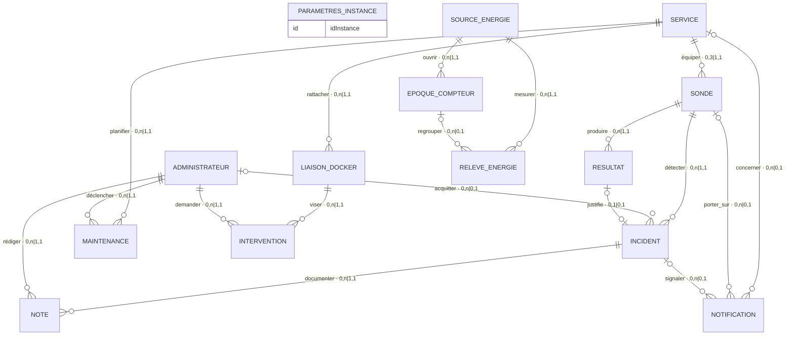

# HomeOps — MCD global (document de travail)

> **Statut :** artefact de travail, **hors spécification**. Consolide en un seul schéma
> les 5 vues thématiques du chapitre 13 (qui constituent déjà « un seul MCD Merise »,
> §13.2) et intègre les 4 corrections de la validation. À valider avant toute
> réintégration dans le `.docx` (qui serait une révision 1.2).
>
> Source des attributs : tableau technique §13.1. Les attributs purement techniques
> (verrous, `rowVersion`, empreintes, `securityStamp`, sessions, `CheckRequest`,
> `ProbeState`, `AuditEvent`, `WorkerHeartbeat`, `EnergyInterval`, journal connecteur)
> restent **hors MCD** par décision du §13.2.

## Corrections intégrées
1. **`RESULTAT — justifie — INCIDENT`** ajoutée (était décrite en §13.2 mais absente des vues).
2. **CIF énergie** : l'époque de `regrouper` doit appartenir à la source de `mesurer`.
3. **`NOTIFICATION`** : contrainte conditionnelle selon le type (sous-contrainte par les cardinalités 0,1).
4. **Pilotage** : au plus une intervention non terminée par couple connecteur/conteneur, toutes liaisons confondues.

---

## 1. Entités et attributs

> **gras** = identifiant conceptuel (souligné en notation Merise).

| Entité | Attributs |
|---|---|
| **PARAMETRES_INSTANCE** *(singleton)* | **idInstance**, initialiseLe, fuseau, versionSchema, emailNotification, themeDefaut (CLAIR/SOMBRE/ROUGE), reductionAnimations, defautsSondes |
| **ADMINISTRATEUR** *(0 avant init, 1 après)* | **idAdmin**, identifiantConnexion, crééLe, dernièreConnexionReussie |
| **SERVICE** | **idService**, nom *(unique, insensible casse)*, adresse, description, notesDepannage, modeSurveillance (NORMAL/MAINTENANCE/SUSPENDED) |
| **SONDE** | **idSonde**, nom, type (HTTP/TCP/TLS), cible, port, sni, intervalleSecondes, timeoutSecondes, statutAttendu, seuils (échecs/réussites), révision |
| **RESULTAT** | **idRésultat**, démarréLe, observéLe, duréeMs, issue (PASS/FAIL/ERROR_INTERNAL), codeErreur, statutHttp, tlsExpireLe, empreinteCertif, révisionSonde, révisionMode |
| **INCIDENT** | **idIncident**, état (OPEN/ACKNOWLEDGED/RESOLVED/CLOSED), premierEchecLe, ouvertLe, résoluLe, closLe, motifCloture (CONFIGURATION_REPLACED), cibleOrigine, typeOrigine, révisionSonde |
| **NOTE** | **idNote**, texte, crééeLe |
| **MAINTENANCE** | **idMaintenance**, débutLe, finPrévue, finEffective, motif |
| **LIAISON_DOCKER** | **idLiaison**, idConnecteur, idConteneur, débutValidité, finValidité, dernierÉtat, dernierÉtatLe, révision |
| **INTERVENTION** | **idIntervention**, action (start/stop/restart), état (QUEUED/RUNNING/SUCCEEDED/FAILED/UNKNOWN), demandéeLe, lancéeLe, terminéeLe, codeRésultat, protectionSnapshot, verrouLevéLe, motifLevée, vérifiéePar, empreinteDemande |
| **SOURCE_ENERGIE** *(au plus 1 active)* | **idSource**, identitéPrise, mode (REAL/SIMULATED), active, adresse, référenceCredential, tarif, puissanceMax, configuréeLe |
| **EPOQUE_COMPTEUR** | **idÉpoque**, débutLe, finLe, motifOuverture |
| **RELEVE_ENERGIE** | **idRelevé**, observéLe *(unique par source)*, puissanceW, compteurWh, qualité, codeErreur |
| **NOTIFICATION** | **idNotification**, type (OUVERTURE/RETABLISSEMENT/TLS/TEST), destinataire, cléÉvénement, date, étatEnvoi, tentatives, prochaineTentativeLe, messageId, dernièreErreur |

---

## 2. Associations (18)

> Lecture : `A (min,max) — association — (min,max) B`.
> Les cardinalités sont celles des vues du §13. ⚑ = patte portant un attribut ou une correction.

| # | Association | Cardinalités | Sens |
|---|---|---|---|
| 1 | SERVICE **équiper** SONDE | (0,3) — (1,1) | un service a 0 à 3 sondes ; une sonde appartient à 1 service |
| 2 | SONDE **produire** RESULTAT | (0,n) — (1,1) | une sonde produit 0..n résultats ; un résultat vient d'1 sonde |
| 3 | SONDE **détecter** INCIDENT | (0,n) — (1,1) | une sonde a 0..n incidents successifs ; un incident vient d'1 sonde |
| 4 | INCIDENT **documenter** NOTE | (0,n) — (1,1) | un incident a 0..n notes ; une note porte sur 1 incident |
| 5 | SERVICE **planifier** MAINTENANCE | (0,n) — (1,1) | un service a 0..n maintenances ; une maintenance vise 1 service |
| 6 | SERVICE **rattacher** LIAISON_DOCKER | (0,n) — (1,1) | un service a 0..n liaisons (historisées) ; une liaison vise 1 service |
| 7 | LIAISON_DOCKER **viser** INTERVENTION | (0,n) — (1,1) | une liaison a 0..n interventions ; une intervention vise 1 liaison |
| 8 | ADMINISTRATEUR **demander** INTERVENTION | (0,n) — (1,1) | l'admin demande 0..n interventions ; chacune a 1 demandeur |
| 9 | ADMINISTRATEUR **rédiger** NOTE | (0,n) — (1,1) | l'admin rédige 0..n notes ; chaque note a 1 auteur |
| 10 | ADMINISTRATEUR **déclencher** MAINTENANCE | (0,n) — (1,1) | l'admin déclenche 0..n maintenances ; chacune a 1 initiateur |
| 11 | ADMINISTRATEUR **acquitter** INCIDENT ⚑ | (0,n) — (0,1) | ⚑ porte `dateAcquittement` ; un incident est acquitté par 0 ou 1 admin |
| 12 | SOURCE_ENERGIE **ouvrir** EPOQUE_COMPTEUR | (0,n) — (1,1) | une source a 0..n époques ; une époque appartient à 1 source |
| 13 | SOURCE_ENERGIE **mesurer** RELEVE_ENERGIE | (0,n) — (1,1) | une source a 0..n relevés ; un relevé vient d'1 source |
| 14 | EPOQUE_COMPTEUR **regrouper** RELEVE_ENERGIE | (0,n) — (0,1) | une époque regroupe 0..n relevés ; un relevé a 0 ou 1 époque |
| 15 | SERVICE **concerner** NOTIFICATION | (0,n) — (0,1) | une notif concerne 0 ou 1 service |
| 16 | SONDE **porter_sur** NOTIFICATION | (0,n) — (0,1) | une notif porte sur 0 ou 1 sonde |
| 17 | INCIDENT **signaler** NOTIFICATION | (0,n) — (0,1) | une notif signale 0 ou 1 incident |
| 18 | RESULTAT **justifie** INCIDENT ⚑ | (0,1) — (0,1) | ⚑ **correction #1** : résultat déclencheur de l'ouverture (nul après purge) |

---

## 3. Contraintes d'intégrité (non exprimables par les seules cardinalités)

| ID | Contrainte | Origine |
|---|---|---|
| CIF-1 | Pour une SONDE : **au plus un INCIDENT actif** (OPEN ou ACKNOWLEDGED) à la fois | RM04, §13.3 (index unique partiel) |
| CIF-2 | Pour un SERVICE : **au plus une MAINTENANCE active** ; modes NORMAL/MAINTENANCE/SUSPENDED exclusifs | DEC06 |
| CIF-3 | Pour un SERVICE : **au plus une LIAISON_DOCKER active** ; un couple (connecteur, conteneur) actif pour **au plus un service** | DEC17, §10.5 |
| **CIF-4** | **Au plus une INTERVENTION non terminée** (QUEUED/RUNNING/UNKNOWN) par couple (connecteur, conteneur), **y compris entre liaisons historiques** — *correction #4* | §10.5, DEC17 |
| **CIF-5** | Pour un RELEVE_ENERGIE : l'EPOQUE_COMPTEUR de `regrouper` **appartient à la SOURCE_ENERGIE** de `mesurer` (même source) — *correction #2* | §13.1 (EnergyReading) |
| CIF-6 | Pour une SOURCE_ENERGIE : **au plus une EPOQUE_COMPTEUR courante** (finLe nul) | §13.2 |
| **NOTIF** | **Contrainte conditionnelle selon `type`** — *correction #3* : TEST → aucune patte ; TLS → `porter_sur`+`concerner` obligatoires, `signaler` interdit ; OUVERTURE/RETABLISSEMENT → `signaler`+`porter_sur`+`concerner` obligatoires | §13.2 (FIG07) |
| SINGL-1 | **PARAMETRES_INSTANCE** : exactement 1 occurrence | §13.2 |
| SINGL-2 | **ADMINISTRATEUR** : 0 avant initialisation, exactement 1 après | RM22 |
| UNIQ-1 | **SERVICE.nom** unique (normalisé, insensible à la casse) | REQ-S02 |
| UNIQ-2 | **RELEVE_ENERGIE** : (source, observéLe) unique | §13.1 |

> **Décisions prises** : NOTIFICATION reste une **entité unique à contrainte conditionnelle**
> (cohérent avec `NotificationOutbox`, une seule table) plutôt qu'un sous-typage
> `NOTIF_TEST`/`NOTIF_TLS`/`NOTIF_INCIDENT`. La patte SONDE est renommée **`porter_sur`**
> (l'ancien `motiver` était connoté TLS alors qu'elle sert aussi aux notifs d'incident).
> *Option de repli* si un jury préfère le « pur » Merise : spécialiser NOTIFICATION en héritage,
> ce qui rendrait les pattes obligatoires par construction.

---

## 4. Rendu Mermaid (topologie — notation crow's foot, pas Merise pur)

> Pour contrôle visuel de la structure. Les cardinalités **Merise exactes** sont au §2 ci-dessus ;
> Mermaid ne sait pas afficher un max de 3 (équiper) ni la notation à ovales.

---

## 5. Notes de validation

- **Modèle entièrement fonctionnel** : les 18 associations ont toutes `max = 1` d'un côté → **aucune relation n,n**, donc **dérivation MLD directe sans table de jonction**. C'est le signe d'un modèle propre. Chaque association deviendra une clé étrangère sur l'entité côté « plusieurs » :
  SONDE→service · RESULTAT→sonde · INCIDENT→sonde (+ FK null `résultat` et `admin`) · NOTE→incident+admin · MAINTENANCE→service+admin · LIAISON→service · INTERVENTION→liaison+admin · EPOQUE→source · RELEVE→source (+ FK null `époque`) · NOTIFICATION→(service,sonde,incident) tous nullables.
- **`PARAMETRES_INSTANCE` sans association** : volontaire (singleton de configuration) — à justifier d'une phrase devant un jury, ce n'est pas une erreur.
- **Attributs partiels dans les vues d'origine** : normal en MCD multi-vues ; ce document porte le jeu complet par entité.
- **14 entités / 18 associations** : taille confortable pour un schéma global unique.
